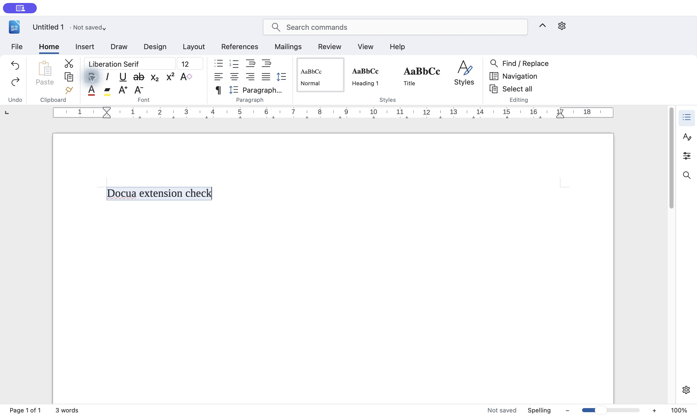

# Docua

Docua is a LibreOffice extension that replaces much of the interface while preserving the existing document engine and canvas.
The project includes source code, build scripts, documentation, and an MPL 2.0 licence.

LibreOffice is an office suite containing several editors:

| Editor | Purpose |
|---|---|
| Writer | Text documents, like Word |
| Calc | Spreadsheets, like Excel |
| Impress | Presentations, like PowerPoint |
| Draw | Drawings and page layouts |

Each editor has a **document engine**, a **document canvas**, and an **interface**.
The engine understands your text, formulas, styles, and objects.
The canvas displays the document and handles editing.
The interface contains the buttons, menus, and panels used to control it.

Docua replaces much of that interface while keeping LibreOffice’s engine and canvas.
Typing, selecting text, calculating formulas, Undo, and saving files still happen inside LibreOffice.
Some dialogs, context menus, the start centre, and Draw’s layer controls remain native.

When you open a document, LibreOffice starts Docua’s **Python adapter**.
This adapter reserves space around the existing canvas and temporarily hides LibreOffice’s standard controls.
A small **native macOS bridge** places Docua’s controls inside that same window.

The controls use local HTML, CSS, and JavaScript displayed through Apple’s WebKit component.
These files come with the extension; they do not load an online document editor.

For example, clicking **Bold** follows this path:


The adapter communicates through **UNO**, LibreOffice’s programming interface.
It reads the current selection and formatting so Docua’s controls reflect the actual document.
LibreOffice continues to handle document formats, so Docua retains LibreOffice’s existing Word and Excel compatibility.

The installation package ends in **`.oxt`**. This is LibreOffice’s extension archive format.
It contains registration information, code, interface assets, and the compiled macOS bridge.
Installation places it in your **user profile**, which stores your preferences and extensions separately from `LibreOffice.app`.
[LibreOffice’s SDK documentation](https://api.libreoffice.org/docs/tools.html) describes its extension deployment tools.

That separation makes normal LibreOffice updates practical: replacing the application can retain Docua and its settings.
The earlier interface package survived a **25.8 → 26.8 upgrade without reinstallation**.
However, the accessibility bridge uses one guarded private LibreOffice view detail.
Future versions still need testing; seamless compatibility cannot yet be guaranteed.

To install Docua:

1. Save your documents and quit LibreOffice.
2. Back up `~/Library/Application Support/LibreOffice/4`.
3. Open `/Applications/LibreOffice.app`.
4. Choose **Tools → Extensions… → Add**.
5. Select `dist/docua-0.1.0-macos-arm64.oxt` from your local build or release download.
6. Restart LibreOffice and open a Writer document.

Open Docua settings using the gear button or **⌘,**.
To restore native controls, select **Settings → Compatibility → Use native LibreOffice interface**.
To remove Docua, close your document windows, remove **Docua** through LibreOffice’s Extensions dialog, and restart.

The renamed extension passed installation, Writer Bold, Undo, settings, native-interface restoration, and removal checks in a fresh profile.
The unpacked OXT also rebuilt to an identical package with the same toolchain.

The project includes:

- [Full beginner explanation](docs/how-it-works.md)
- [Installation and recovery instructions](docs/installation.md)
- [Architecture reference](docs/architecture.md)
- [Release instructions](docs/releasing.md)
- [Licence](LICENSE) and [asset notices](NOTICE.txt)

To build Docua from the project root:

```sh
python3 scripts/build.py
python3 scripts/check_package.py dist/docua-0.1.0-macos-arm64.oxt
```

The build requires macOS, Apple’s Command Line Tools, and Python 3.
Generated packages appear in `dist`.

This version is an **experimental macOS Apple Silicon preview**.
It still needs broader accessibility, Impress/Draw, and clean-Mac distribution testing.
The native library currently uses an ad-hoc signature.


